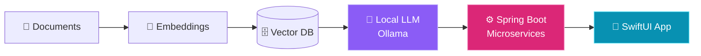

 

## 💫 About Me

I'm a **builder at heart**: I turn ideas into working systems that solve real problems. From automation tools for small businesses to full-stack platforms built from scratch, I focus on creating software that is **simple, fast, and genuinely useful**.

As an **English + Information Technology** major, I care a lot about clarity. I break down complex concepts, design clean architectures, and build things people can actually rely on.

  

## 🎯 What I'm Specializing In

  

<table>
  <tr>
    <td width="33%" valign="top">
      <h3 align="center">🧠 AI Engineering Local LLM</h3>
      
Private, fast, offline-first AI. Running and fine-tuning open models on local hardware, wired into real products with RAG.

      

        
        
        
        
        
        
        
      

    </td>
    <td width="33%" valign="top">
      <h3 align="center">⚙️ Spring Microservices Backend Architecture</h3>
      
Resilient, observable, independently deployable services with clean boundaries, secure auth, and automated delivery.

      

        
        
        
        
        
        
        
      

    </td>
    <td width="33%" valign="top">
      <h3 align="center">📱 iOS Development SwiftUI</h3>
      
Native, fluid, declarative interfaces with polished animations, clean state management, and thoughtful UX.

      

        
        
        
        
        
        
      

    </td>
  </tr>
</table>

### 🔗 How it all connects

## 🛠️ Tech Arsenal

**Languages** 

**Backend & AI** 

**Frontend** 

**DevOps & Cloud** 
 

**Design & Tools** 

## 💻 Portfolio & Projects

Web apps, automation systems, dashboards, and AI experiments.

## 📊 GitHub Stats

<picture>
  <source media="(prefers-color-scheme: dark)" srcset="https://raw.githubusercontent.com/Soeun-Sovannarith/Soeun-Sovannarith/output/snake-dark.svg" />
  <source media="(prefers-color-scheme: light)" srcset="https://raw.githubusercontent.com/Soeun-Sovannarith/Soeun-Sovannarith/output/snake-light.svg" />
  
</picture>

## 🤝 Let's Connect

If you're building something interesting, I'm always open to chat or collaborate.

